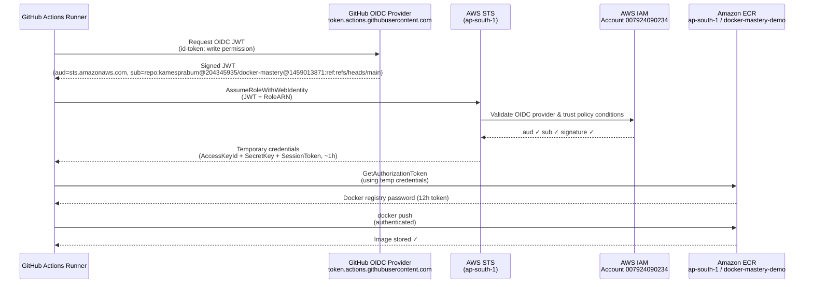
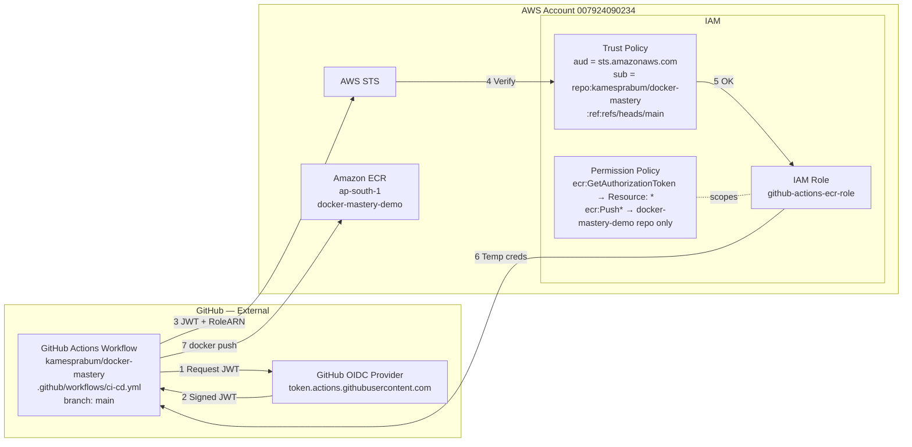

# GitHub Actions → AWS ECR via OIDC Authentication

> **This document is part of the Phase 3 — Advanced section of the Docker Mastery project.**
> It explains the production-grade authentication architecture used to push Docker images
> to Amazon ECR without storing any AWS credentials anywhere.

---

## Infrastructure Reference

| Parameter | Value |
|---|---|
| **GitHub username** | `kamesprabum` |
| **GitHub repository** | `docker-mastery` |
| **Branch** | `main` |
| **AWS Account ID** | `007924090234` |
| **AWS Region** | `ap-south-1` (Asia Pacific — Mumbai) |
| **ECR repository name** | `docker-mastery-demo` |
| **ECR repository ARN** | `arn:aws:ecr:ap-south-1:007924090234:repository/docker-mastery-demo` |
| **IAM role name** | `github-actions-ecr-role` |
| **IAM role ARN** | `arn:aws:iam::007924090234:role/github-actions-ecr-role` |
| **OIDC provider URL** | `https://token.actions.githubusercontent.com` |
| **OIDC audience** | `sts.amazonaws.com` |
| **OIDC provider ARN** | `arn:aws:iam::007924090234:oidc-provider/token.actions.githubusercontent.com` |

---

## Table of Contents

1. [Why not IAM user access keys?](#1-why-not-iam-user-access-keys)
2. [What is GitHub OIDC?](#2-what-is-github-oidc)
3. [What does an IAM role do?](#3-what-does-an-iam-role-do)
4. [What does a trust policy do?](#4-what-does-a-trust-policy-do)
5. [What does a permission policy do?](#5-what-does-a-permission-policy-do)
6. [How GitHub obtains temporary AWS credentials](#6-how-github-obtains-temporary-aws-credentials)
7. [How the Docker image reaches ECR](#7-how-the-docker-image-reaches-ecr)
8. [Architecture Diagrams](#8-architecture-diagrams)
9. [AWS Setup: Configure the OIDC Provider](#9-aws-setup-configure-the-oidc-provider)
10. [AWS Setup: Create the IAM Role](#10-aws-setup-create-the-iam-role)
11. [GitHub Setup: Configure Repository Variables](#11-github-setup-configure-repository-variables)
12. [Testing and Troubleshooting](#12-testing-and-troubleshooting)
13. [Verification Checklist](#13-verification-checklist)

---

## 1. Why Not IAM User Access Keys?

An **IAM user** is a permanent AWS identity with a username and password (or access keys). When
you create an IAM user for a CI/CD system and generate access keys, you get two static strings:
`AWS_ACCESS_KEY_ID` and `AWS_SECRET_ACCESS_KEY`. These keys **never expire by default**.

### Problems with static access keys in CI/CD

| Risk | Explanation |
|---|---|
| **Credential leakage** | Keys stored in GitHub Secrets can be accidentally logged, exposed in a fork, or leaked via a supply-chain attack on a third-party Action. Once leaked, they are valid until manually rotated. |
| **No automatic expiry** | A leaked key remains valid until someone notices and rotates it — which may be never. |
| **Broad blast radius** | If a key is over-permissioned (e.g., `AdministratorAccess`), an attacker can do anything in your AWS account. |
| **Manual rotation burden** | You must remember to rotate keys periodically, update them everywhere they are used, and audit when they were last used. |
| **No identity context** | CloudTrail logs show the IAM user name but not *which workflow run, which branch, or which commit* triggered the action. |
| **GitHub Secrets ≠ Zero-trust** | Secrets are encrypted at rest, but they are injected as plaintext environment variables into the runner process — accessible to any step in the job. |

### The alternative: OIDC with temporary credentials

With OIDC (explained below), **no long-lived credentials exist anywhere**. GitHub proves its
identity cryptographically to AWS, and AWS returns credentials that expire automatically. If
credentials are somehow captured, they are already useless by the time anyone tries to use them.

---

## 2. What is GitHub OIDC?

**OpenID Connect (OIDC)** is a standard authentication protocol built on top of OAuth 2.0.
It allows one system to prove its identity to another using cryptographically signed tokens,
without exchanging passwords or secrets.

**GitHub Actions** ships a built-in OIDC identity provider. When you add `id-token: write` to
a workflow's `permissions`, GitHub can generate a **JSON Web Token (JWT)** for each job run.
This JWT contains verifiable claims including:

| Claim | Value for this project | Meaning |
|---|---|---|
| `iss` | `https://token.actions.githubusercontent.com` | Issuer — GitHub's OIDC endpoint |
| `aud` | `sts.amazonaws.com` | Audience — the AWS service that will consume the token |
| `sub` | `repo:kamesprabum@204345935/docker-mastery@1459013871:ref:refs/heads/main` | Subject — the specific repo and branch |
| `repository` | `kamesprabum/docker-mastery` | The full GitHub repository |
| `ref` | `refs/heads/main` | The Git ref (branch or tag) that triggered the run |
| `sha` | `a3f9c12...` | The commit SHA |
| `job_workflow_ref` | `kamesprabum/docker-mastery/.github/workflows/ci-cd.yml@refs/heads/main` | The workflow file |

The JWT is **signed by GitHub's private key**. AWS can verify the signature using GitHub's public
JWKS endpoint (fetched automatically when the OIDC provider is registered). This means AWS can
trust the claims without ever communicating with GitHub directly during authentication.

---

## 3. What Does an IAM Role Do?

An **IAM Role** is an AWS identity that:

- Has **no username or password**.
- Can be **assumed** temporarily by a trusted entity (a person, service, or external identity provider).
- Issues **temporary Security Token Service (STS) credentials** that expire automatically.
- Carries a **permissions policy** that defines what AWS actions are allowed.

Roles are the correct mechanism for granting AWS access to workloads — whether running in EC2,
Lambda, ECS, or external systems like GitHub Actions.

When a GitHub Actions job assumes the role, it receives:
- `AWS_ACCESS_KEY_ID` — temporary
- `AWS_SECRET_ACCESS_KEY` — temporary
- `AWS_SESSION_TOKEN` — proves the credentials are temporary (required by AWS for STS-issued keys)

These expire (typically in 1 hour) and cannot be refreshed without re-authenticating through OIDC.

---

## 4. What Does a Trust Policy Do?

A **trust policy** (also called a *role trust relationship*) answers the question:
**"Who is allowed to assume this role?"**

It is a JSON policy attached directly to the IAM role. Without a matching trust policy,
no one can assume the role regardless of what permissions it has.

### This project's trust policy

```json
{
  "Version": "2012-10-17",
  "Statement": [
    {
      "Sid": "AllowGitHubActionsOIDC",
      "Effect": "Allow",
      "Principal": {
        "Federated": "arn:aws:iam::007924090234:oidc-provider/token.actions.githubusercontent.com"
      },
      "Action": "sts:AssumeRoleWithWebIdentity",
      "Condition": {
        "StringEquals": {
          "token.actions.githubusercontent.com:aud": "sts.amazonaws.com",
          "token.actions.githubusercontent.com:sub": "repo:kamesprabum@204345935/docker-mastery@1459013871:ref:refs/heads/main"
        }
      }
    }
  ]
}
```

### What each field means

| Field | Purpose |
|---|---|
| `Principal.Federated` | Only GitHub's OIDC provider registered in account `007924090234` can initiate a role assumption |
| `Action: sts:AssumeRoleWithWebIdentity` | The specific STS action used for OIDC-based role assumption |
| `Condition: aud` | The JWT audience must be `sts.amazonaws.com` — prevents tokens issued for other services from being reused |
| `Condition: sub` | Locks the role to **this specific repository (`kamesprabum/docker-mastery`) and this specific branch (`main`)** — a workflow from any other repo, fork, or branch is rejected |

The `sub` condition is the critical security gate. Without it, any GitHub Actions workflow
in any public repository could potentially assume this role.

---

## 5. What Does a Permission Policy Do?

A **permission policy** (identity-based policy) answers the question:
**"What can this role do once assumed?"**

This project uses a **least-privilege custom policy** that grants only the six ECR API actions
required to push a Docker image — nothing more.

### Why least-privilege?

If the role or workflow were ever compromised, the attacker could only push images to this one
ECR repository. They could not:
- Delete repositories or images (`ecr:DeleteRepository`, `ecr:BatchDeleteImage`)
- Read images from other repositories
- Modify IAM policies
- Access any other AWS service

### This project's ECR push policy

```json
{
  "Version": "2012-10-17",
  "Statement": [
    {
      "Sid": "ECRGetAuthorizationToken",
      "Effect": "Allow",
      "Action": ["ecr:GetAuthorizationToken"],
      "Resource": "*"
    },
    {
      "Sid": "ECRPushImageToSpecificRepository",
      "Effect": "Allow",
      "Action": [
        "ecr:BatchCheckLayerAvailability",
        "ecr:BatchGetImage",
        "ecr:InitiateLayerUpload",
        "ecr:UploadLayerPart",
        "ecr:CompleteLayerUpload",
        "ecr:PutImage"
      ],
      "Resource": "arn:aws:ecr:ap-south-1:007924090234:repository/docker-mastery-demo"
    }
  ]
}
```

> [!NOTE]
> `ecr:GetAuthorizationToken` requires `Resource: "*"` because it is a **registry-level** action
> (it authenticates Docker to the ECR registry endpoint, not to a specific repository). This is an
> AWS API design constraint — it cannot be scoped to a repository ARN. All other actions are
> scoped to the specific repository ARN `arn:aws:ecr:ap-south-1:007924090234:repository/docker-mastery-demo`.

---

## 6. How GitHub Obtains Temporary AWS Credentials

This is the step-by-step flow of what happens when the workflow runs:

```
1.  GitHub runner starts the build-scan-push job.

2.  Runner requests an OIDC JWT from GitHub's token endpoint.
    (Enabled by the `id-token: write` workflow permission.)

3.  GitHub generates a signed JWT containing:
        aud = sts.amazonaws.com
        sub = repo:kamesprabum@204345935/docker-mastery@1459013871:ref:refs/heads/main
        iss = https://token.actions.githubusercontent.com
        ... (commit SHA, ref, workflow path, etc.)

4.  The `aws-actions/configure-aws-credentials@v4` action calls:
        AWS STS: AssumeRoleWithWebIdentity
          WebIdentityToken = <the JWT from step 3>
          RoleArn          = arn:aws:iam::007924090234:role/github-actions-ecr-role
          RoleSessionName  = github-actions-ecr-push

5.  AWS STS validates the JWT:
    a. Fetches GitHub's JWKS public keys (cached at the OIDC provider).
    b. Verifies the JWT cryptographic signature.
    c. Checks: aud == sts.amazonaws.com        (matches trust policy condition)
    d. Checks: sub == repo:kamesprabum@204345935/docker-mastery@1459013871:ref:refs/heads/main
                                               (matches trust policy condition)

6.  Conditions match → STS returns temporary credentials:
        AWS_ACCESS_KEY_ID     (temporary, valid ~1 hour)
        AWS_SECRET_ACCESS_KEY (temporary)
        AWS_SESSION_TOKEN     (mandatory for STS-issued credentials)

7.  The action exports these as masked environment variables.
    All subsequent AWS API calls in the job use them automatically.

8.  Credentials expire when the job ends or the session duration elapses.
    They cannot be extended without re-running the OIDC flow.
```

No secrets are stored. No credentials are transmitted out-of-band. The JWT is the only
credential exchanged, and it cannot be reused for a different role, region, or AWS account.

---

## 7. How the Docker Image Reaches ECR

```
1. docker build (via docker/build-push-action)
   Builds the multi-stage Dockerfile in phase3-advanced/.
   The image is loaded into the runner's local Docker daemon.
   GHA layer cache (type=gha) is used so unchanged layers are
   pulled from cache on repeat builds — significantly faster.

2. Trivy scan
   Scans the locally-loaded image for CRITICAL/HIGH CVEs.
   If any are found, the pipeline fails here — nothing is pushed.

3. aws-actions/amazon-ecr-login
   Calls ECR GetAuthorizationToken using the temporary STS
   credentials to get a time-limited Docker registry password,
   then runs `docker login` against the ECR registry endpoint:
     007924090234.dkr.ecr.ap-south-1.amazonaws.com

4. docker tag
   Tags the local image with the full ECR repository URI:
     007924090234.dkr.ecr.ap-south-1.amazonaws.com/docker-mastery-demo:<sha>
     007924090234.dkr.ecr.ap-south-1.amazonaws.com/docker-mastery-demo:latest

5. docker push
   - ECR checks which layers already exist (BatchCheckLayerAvailability)
   - Only missing layers are uploaded (InitiateLayerUpload,
     UploadLayerPart, CompleteLayerUpload)
   - The image manifest is written (PutImage)
```

---

## 8. Architecture Diagrams

### Authentication Flow



### Trust Boundary



---

## 9. AWS Setup: Configure the OIDC Provider

> [!IMPORTANT]
> The GitHub OIDC provider is registered **once per AWS account**, not once per repository.
> Check first before creating it: **IAM → Identity providers** — look for
> `token.actions.githubusercontent.com`. If it already exists, skip to step 10.

### Via AWS Console

1. Open **IAM Console** → **Identity providers** → **Add provider**
2. Select **OpenID Connect**
3. Enter these values exactly:

   | Field | Value |
   |---|---|
   | Provider URL | `https://token.actions.githubusercontent.com` |
   | Audience | `sts.amazonaws.com` |

4. Click **Get thumbprint** (AWS fetches and verifies GitHub's TLS certificate chain)
5. Click **Add provider**

The resulting provider ARN will be:
`arn:aws:iam::007924090234:oidc-provider/token.actions.githubusercontent.com`

### Via AWS CLI

```bash
aws iam create-open-id-connect-provider \
  --url https://token.actions.githubusercontent.com \
  --client-id-list sts.amazonaws.com \
  --thumbprint-list 6938fd4d98bab03faadb97b34396831e3780aea1
```

> [!NOTE]
> The thumbprint represents GitHub's TLS certificate root. AWS additionally validates OIDC
> providers using their JWKS endpoint directly, so the thumbprint value is not the primary
> trust mechanism — but it is still required by the API.

---

## 10. AWS Setup: Create the IAM Role

### Step A — Create the role

1. Open **IAM Console** → **Roles** → **Create role**
2. Select **Web identity**
3. Configure:

   | Field | Value |
   |---|---|
   | Identity provider | `token.actions.githubusercontent.com` |
   | Audience | `sts.amazonaws.com` |
   | GitHub organization | `kamesprabum` |
   | GitHub repository | `docker-mastery` |
   | GitHub branch | `main` |

4. Click **Next**

> [!TIP]
> The console pre-populates the trust policy from these fields. After creation, verify it
> matches [`aws-iam/trust-policy.json`](aws-iam/trust-policy.json) exactly.

### Step B — Attach the permission policy

1. On the **Add permissions** screen → **Create inline policy**
2. Switch to the **JSON editor**
3. Paste the contents of [`aws-iam/ecr-push-policy.json`](aws-iam/ecr-push-policy.json) exactly as-is — all values are already filled in with the correct account ID, region, and repository name
4. Name the policy: `github-actions-ecr-push-policy`
5. Click **Create policy**

### Step C — Name and finalize

| Field | Value |
|---|---|
| Role name | `github-actions-ecr-role` |
| Description | `Assumed by GitHub Actions OIDC to push images to the docker-mastery-demo ECR repository in ap-south-1` |

6. Click **Create role**
7. Open the created role and **copy the Role ARN**:
   `arn:aws:iam::007924090234:role/github-actions-ecr-role`

### Step D — Verify the trust policy

Go to the role → **Trust relationships** tab and confirm it matches exactly:

```json
{
  "Version": "2012-10-17",
  "Statement": [
    {
      "Sid": "AllowGitHubActionsOIDC",
      "Effect": "Allow",
      "Principal": {
        "Federated": "arn:aws:iam::007924090234:oidc-provider/token.actions.githubusercontent.com"
      },
      "Action": "sts:AssumeRoleWithWebIdentity",
      "Condition": {
        "StringEquals": {
          "token.actions.githubusercontent.com:aud": "sts.amazonaws.com",
          "token.actions.githubusercontent.com:sub": "repo:kamesprabum@204345935/docker-mastery@1459013871:ref:refs/heads/main"
        }
      }
    }
  ]
}
```

---

## 11. GitHub Setup: Configure Repository Variables

> [!IMPORTANT]
> These are **Variables** (not Secrets). The role ARN and region are configuration, not
> credentials. Variables are visible in workflow logs and to collaborators — which is correct
> here because knowing a role ARN does not grant the ability to assume it.

### Where to set them

**GitHub → `docker-mastery` repository → Settings → Secrets and variables → Actions → Variables tab**

### Required variables

| Variable name | Exact value |
|---|---|
| `AWS_REGION` | `ap-south-1` |
| `AWS_ROLE_ARN` | `arn:aws:iam::007924090234:role/github-actions-ecr-role` |
| `ECR_REPOSITORY` | `docker-mastery-demo` |

### Required secrets (Docker Hub only)

| Secret name | Description |
|---|---|
| `DOCKERHUB_USERNAME` | Your Docker Hub username |
| `DOCKERHUB_TOKEN` | Docker Hub access token (create at hub.docker.com → Account Settings → Security) |

> [!CAUTION]
> Delete `AWS_ACCESS_KEY_ID` and `AWS_SECRET_ACCESS_KEY` from your repository secrets if they
> exist. They are no longer used and their existence creates unnecessary risk.

---

## 12. Testing and Troubleshooting

### Trigger the pipeline

```bash
# Any commit to main triggers the workflow (no path filter on the root workflow)
git commit --allow-empty -m "ci: test OIDC pipeline"
git push origin main
```

### Common errors and fixes

#### `Error: Credentials could not be loaded`

**Cause:** `id-token: write` permission is missing.

**Fix:** Confirm the workflow has at the top level:
```yaml
permissions:
  contents: read
  id-token: write
```

#### `Not authorized to perform sts:AssumeRoleWithWebIdentity`

**Cause:** The trust policy `sub` condition does not match the workflow's subject claim.

**Fix:**
1. Go to **IAM → Roles → github-actions-ecr-role → Trust relationships**
2. Confirm the `sub` value is exactly:
   `repo:kamesprabum@204345935/docker-mastery@1459013871:ref:refs/heads/main`
3. Confirm `Principal.Federated` is:
   `arn:aws:iam::007924090234:oidc-provider/token.actions.githubusercontent.com`

**Debug — print the JWT claims:**
```yaml
- name: Debug OIDC token claims
  run: |
    TOKEN=$(curl -sSL \
      -H "Authorization: bearer $ACTIONS_ID_TOKEN_REQUEST_TOKEN" \
      "$ACTIONS_ID_TOKEN_REQUEST_URL&audience=sts.amazonaws.com" | jq -r .value)
    echo "$TOKEN" | cut -d. -f2 | base64 -d 2>/dev/null | jq .
```
Compare the `sub` field in the output with the trust policy condition.

#### `Error: Access denied when calling ecr:PutImage`

**Cause:** The permission policy `Resource` ARN is wrong (wrong region, account, or repo name).

**Fix:** Confirm the ARN in the policy is exactly:
`arn:aws:ecr:ap-south-1:007924090234:repository/docker-mastery-demo`

#### `vars.AWS_ROLE_ARN is empty / evaluate to empty string`

**Cause:** The GitHub Actions Variable has not been created.

**Fix:** Go to **Settings → Secrets and variables → Actions → Variables** and confirm
`AWS_ROLE_ARN`, `AWS_REGION`, and `ECR_REPOSITORY` all exist.

#### Trivy scan fails

**Cause:** A CRITICAL or HIGH CVE was found in the image — this is intentional. The pipeline
blocks the push to prevent shipping a vulnerable image.

**Fix options:**
- Update the pinned dependency in `phase3-advanced/requirements.txt`
- Rebuild against a newer base image digest
- Add a `.trivyignore` file with a justified exception if the CVE is a false-positive

### Verify authentication in CloudTrail

1. **AWS CloudTrail → Event history**
2. Filter: **Event name = `AssumeRoleWithWebIdentity`**
3. Confirm the event shows:
   - `userIdentity.type` = `WebIdentityUser`
   - `userIdentity.principalId` contains `github-actions-ecr-push`
   - `requestParameters.roleArn` = `arn:aws:iam::007924090234:role/github-actions-ecr-role`

---

## 13. Verification Checklist

### AWS

- [ ] GitHub OIDC Identity Provider exists: `token.actions.githubusercontent.com`, audience `sts.amazonaws.com`
- [ ] Provider ARN: `arn:aws:iam::007924090234:oidc-provider/token.actions.githubusercontent.com`
- [ ] IAM role `github-actions-ecr-role` created in account `007924090234`
- [ ] Role ARN: `arn:aws:iam::007924090234:role/github-actions-ecr-role`
- [ ] Trust policy `aud` condition: `sts.amazonaws.com`
- [ ] Trust policy `sub` condition: `repo:kamesprabum@204345935/docker-mastery@1459013871:ref:refs/heads/main`
- [ ] Trust policy `Principal.Federated`: `arn:aws:iam::007924090234:oidc-provider/token.actions.githubusercontent.com`
- [ ] ECR push policy attached; `ecr:GetAuthorizationToken` has `Resource: "*"`
- [ ] All other ECR actions scoped to `arn:aws:ecr:ap-south-1:007924090234:repository/docker-mastery-demo`
- [ ] No `AdministratorAccess` or broad managed policies attached to the role

### GitHub

- [ ] Variable `AWS_REGION` = `ap-south-1`
- [ ] Variable `AWS_ROLE_ARN` = `arn:aws:iam::007924090234:role/github-actions-ecr-role`
- [ ] Variable `ECR_REPOSITORY` = `docker-mastery-demo`
- [ ] Secret `DOCKERHUB_USERNAME` present
- [ ] Secret `DOCKERHUB_TOKEN` present
- [ ] Secrets `AWS_ACCESS_KEY_ID` and `AWS_SECRET_ACCESS_KEY` **deleted**

### Workflow (`.github/workflows/ci-cd.yml`)

- [ ] `permissions: id-token: write` present
- [ ] `permissions: contents: read` present
- [ ] `aws-actions/configure-aws-credentials@v4` uses `role-to-assume` (not `aws-access-key-id`)
- [ ] `role-session-name: github-actions-ecr-push` set
- [ ] `IMAGE_NAME: docker-mastery` (not `docker-mastery-demo`)
- [ ] Build context is `phase3-advanced` (not `.`)
- [ ] No `aws-access-key-id` or `aws-secret-access-key` inputs anywhere

### End-to-End Test

- [ ] Push a commit to `main` → workflow triggers
- [ ] `Lint & Test` job passes
- [ ] `Build, Scan & Push` job starts
- [ ] Trivy scan passes (or expected failure on CVE)
- [ ] `Configure AWS credentials (OIDC)` step succeeds
- [ ] `Log in to Amazon ECR` step succeeds
- [ ] `Push to Amazon ECR` step succeeds
- [ ] Image appears in **AWS ECR → Repositories → `docker-mastery-demo`** in `ap-south-1`
- [ ] Image tags `latest` and `<sha>` are present in ECR
- [ ] CloudTrail shows successful `AssumeRoleWithWebIdentity` from `github-actions-ecr-push`
